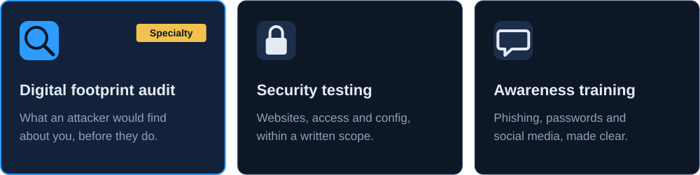

<p align="center">
  <a href="https://mabimzaa.github.io">
    
  </a>
</p>


I find what the internet knows about people and companies, before someone with worse intentions does.

My specialty is **OSINT** (open-source intelligence): rebuilding an organisation's attack surface using nothing but public sources. Leaked credentials, exposed staff, forgotten subdomains, a badge photographed on Instagram. Then I help close the gaps.


<a href="case-001/evidence.jpg"></a>

An informant sent me a single photo before going silent. Somewhere in it is the place they were watching, and somewhere else is what they wanted me to know. **Click the card to open the evidence.** Everything you need is in this repository: no social engineering, no attacking anything.

**Submit your flag**

1. Build the string `answer:your-github-username`, all lowercase.
2. Hash it with SHA-256. Your flag is unique to you, so copying someone else's won't work.
   - In your browser: [CyberChef](https://gchq.github.io/CyberChef/#recipe=SHA2('256',64,160))
   - Bash:
     ```bash
     echo -n "answer:username" | sha256sum
     ```
   - PowerShell:
     ```powershell
     $s = "answer:username"
     -join ([Security.Cryptography.SHA256]::Create().ComputeHash([Text.Encoding]::UTF8.GetBytes($s)) | % { $_.ToString("x2") })
     ```
3. [Open an issue](https://github.com/Mabimzaa/Mabimzaa/issues/new?title=case-001%3A%20PASTE-YOUR-HASH-HERE&body=Submitting%20my%20flag%20for%20case%20001.) with the title `case-001: <your hash>`.

A bot checks your flag within a minute. Solve it and your name goes up below.

<details>
<summary><b>Stuck? Open a hint</b></summary>
<br>

<details>
<summary>Hint 1</summary>
<br>
A photo often remembers more than it shows.
</details>

<details>
<summary>Hint 2</summary>
<br>
The informant says their notes were deleted. On GitHub, deleted rarely means gone. Look at the history.
</details>

<details>
<summary>Hint 3</summary>
<br>
Some messages are encoded, not encrypted. The trailing characters are a clue to the format.
</details>

</details>


<!-- HOF:START -->
Nobody has cracked this case yet. Be the first.
<!-- HOF:END -->


<a href="https://mabimzaa.github.io"></a>


- **CTFs** with [Corvus Mind](https://shsh-commits.github.io/corvusmind/), an OSINT-focused team
- **Hack The Box** and **TryHackMe**: recon, web exploitation, privilege escalation

- **Rules I work by**: no engagement without written authorisation, and collected data is deleted at the end


<p align="center">
  <a href="https://mabimzaa.github.io"></a>
  <a href="mailto:mabimzaa@proton.me"></a>
  <a href="https://shsh-commits.github.io/corvusmind/"></a>
</p>

<p align="center"><sub>French / English</sub></p>

<details>
<summary><b>Version française</b></summary>
<br>

Je trouve ce qu'Internet sait des personnes et des entreprises, avant que quelqu'un de mal intentionné ne le fasse.

Ma spécialité, c'est l'**OSINT** (renseignement en sources ouvertes) : reconstituer la surface d'attaque d'une organisation uniquement à partir d'informations publiques. Identifiants qui ont fuité, équipes exposées, sous-domaines oubliés, badge photographié sur Instagram. Ensuite, j'aide à refermer les brèches.

**Enquête ouverte 001 : un informateur m'a envoyé une seule photo avant de disparaître.** Tout ce qu'il faut pour la résoudre se trouve dans ce dépôt. Le flag est le SHA-256 de `réponse:ton-pseudo-github` en minuscules, à soumettre en ouvrant un issue intitulé `case-001: <ton hash>`. Les indices et le Hall of fame sont plus haut.

- **Audit d'empreinte numérique** : l'enquête qu'un attaquant mènerait avant de vous cibler, livrée sous forme de rapport clair et priorisé
- **Tests de sécurité** : site, accès et configuration, toujours dans un périmètre autorisé par écrit
- **Sensibilisation** : hameçonnage, mots de passe et réseaux sociaux, pour des équipes non techniques

Je m'entraîne en CTF avec [Corvus Mind](https://shsh-commits.github.io/corvusmind/) et sur Hack The Box / TryHackMe.

Contact : [mabimzaa.github.io](https://mabimzaa.github.io) · mabimzaa@proton.me

</details>
