  

### whoami

I find what the internet knows about people and companies, before someone with worse intentions does.

My specialty is **OSINT** (open-source intelligence): rebuilding an organisation's attack surface using nothing but public sources. Leaked credentials, exposed staff, forgotten subdomains, a badge photographed on Instagram. Then I help close the gaps.

### What I work on

| | |
|---|---|
| **Digital footprint audits** | The investigation an attacker would run before targeting you, delivered as a clear, prioritised report |
| **Security testing** | Websites, access points and configuration, always within a scope authorised in writing |
| **Awareness training** | Phishing, passwords and social media hygiene for teams that aren't technical |

### Where I train

- **CTFs** with [Corvus Mind](https://shsh-commits.github.io/corvusmind/), an OSINT-focused team
- **Hack The Box** and **TryHackMe**: recon, web exploitation, privilege escalation

### Rules I work by

No engagement without written authorisation. Data collected stays confidential and is deleted at the end.

### Contact

[mabimzaa.github.io](https://mabimzaa.github.io) · mabimzaa@proton.me · French / English

<b>Version française</b>

 

Je trouve ce qu'Internet sait des personnes et des entreprises, avant que quelqu'un de mal intentionné ne le fasse.

Ma spécialité, c'est l'**OSINT** (renseignement en sources ouvertes) : reconstituer la surface d'attaque d'une organisation uniquement à partir d'informations publiques. Identifiants qui ont fuité, équipes exposées, sous-domaines oubliés, badge photographié sur Instagram. Ensuite, j'aide à refermer les brèches.

- **Audit d'empreinte numérique** : l'enquête qu'un attaquant mènerait avant de vous cibler, livrée sous forme de rapport clair et priorisé
- **Tests de sécurité** : site, accès et configuration, toujours dans un périmètre autorisé par écrit
- **Sensibilisation** : hameçonnage, mots de passe et réseaux sociaux, pour des équipes non techniques

Je m'entraîne en CTF avec [Corvus Mind](https://shsh-commits.github.io/corvusmind/) et sur Hack The Box / TryHackMe.

Contact : [mabimzaa.github.io](https://mabimzaa.github.io) · mabimzaa@proton.me

